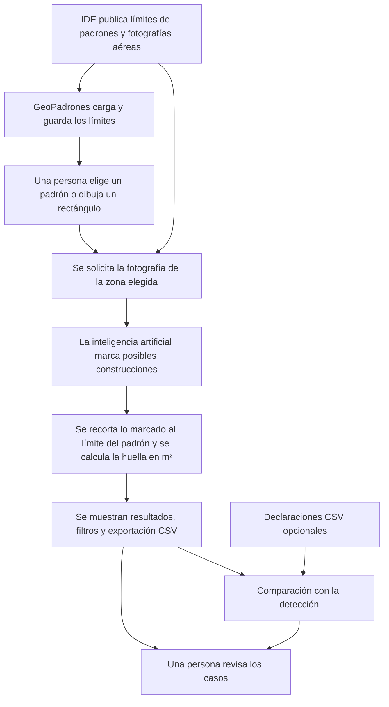

# Cómo funciona GeoPadrones Lavalleja

GeoPadrones ayuda a consultar padrones de Lavalleja y a localizar posibles construcciones visibles en fotografías aéreas. Puede estimar cuántos metros cuadrados ocupan en el terreno, comparar esos resultados con una declaración cargada por el usuario y facilitar su revisión. Es una herramienta de apoyo: sus resultados no son una mensura ni prueban por sí solos una infracción.

Un **padrón** es la parcela identificada por Catastro. Una **ortofoto** es una fotografía aérea corregida para que sus posiciones puedan compararse con un mapa. Una **huella** es la superficie que ocupa una construcción vista desde arriba.

## De dónde vienen los datos y cómo se cargan

- **Límites de los padrones:** del parcelario urbano oficial publicado por la [Infraestructura de Datos Espaciales de Uruguay (IDE)](https://mapas.ide.uy/geoserver-vectorial/ideuy/wfs). El sistema descarga los datos por partes, comprueba y guarda las geometrías y agrupa las piezas que pertenecen al mismo padrón. También conserva la versión y la fuente de lo importado. La carga documentada reunió 25.953 padrones de 18 localidades; es una cifra de esa descarga, no una garantía de que la fuente siga igual.
- **Fotografías aéreas:** la imagen registrada para el análisis proviene del [vuelo de IDE sobre Minas de diciembre de 2025](https://catalogodatos.gub.uy/dataset/ide-vuelo-fotogrametrico-minas-diciembre-2025). Cuando se solicita un análisis, el sistema pide el recorte correspondiente a la parcela. La cobertura disponible para la detección no comprende automáticamente todo Lavalleja y la imagen muestra el estado de la fecha del vuelo.
- **Categorías de suelo y mapa:** las categorías se importaron de otro conjunto publicado por IDE. El mapa de calles utiliza [OpenStreetMap](https://www.openstreetmap.org/copyright). Una capa aérea histórica puede consultarse visualmente; no se utiliza para el análisis de construcciones descrito aquí.
- **Declaraciones:** si una persona carga un archivo CSV con datos declarados, el sistema intenta relacionar cada fila con su padrón y permite revisar incidencias antes de comparar. Esos datos no provienen automáticamente de la fotografía.

Las descargas e importaciones oficiales se realizan mediante las herramientas de carga del proyecto; no debe suponerse que los datos se actualizan solos. La procedencia y los detalles de la carga están en [Fuentes y procedencia](docs/data-sources/PROVENANCE.md).

## El recorrido, paso a paso

El análisis se ejecuta en segundo plano. En **Selección múltiple** se puede dibujar un rectángulo y solicitar un lote de hasta 5.000 padrones; el sistema lo divide en trabajos más pequeños. Después muestra el avance y permite filtrar por resultado, ordenar por superficie y descargar todos los casos filtrados. Los resultados y sus fuentes quedan registrados para consultarlos posteriormente.

Para medir, el sistema conserva únicamente la parte de la construcción detectada que cae dentro de la parcela y calcula su superficie en un sistema de medidas en metros. Por ejemplo, si la parte visible ocupa 80 m² dentro del límite, la huella estimada será 80 m². **No suma los pisos**: una casa de dos plantas con esa misma huella podría tener más superficie edificada total.

## Qué inteligencia artificial utiliza y por qué

El sistema utiliza **FLAIR-INC RGB, U-Net con ResNet-34**, un modelo publicado por el Instituto Nacional de Información Geográfica y Forestal de Francia (IGN). Se eligió porque está entrenado para identificar elementos del terreno, incluidas construcciones, en fotografías aéreas de alta resolución y dispone de una versión pública y documentada. El modelo marca zonas que parecen edificios; el cálculo de metros lo realiza después GeoPadrones al cruzar esas zonas con el límite de cada padrón.

El modelo y su documentación están disponibles en la [ficha oficial del IGN, en la versión utilizada](https://huggingface.co/IGNF/FLAIR-INC_rgb_12cl_resnet34-unet/blob/533aa8f000dd36f2d07279ae73e0263d5f23a976/README.md). Fue desarrollado principalmente con imágenes aéreas francesas; las características de las imágenes y construcciones locales pueden ser distintas.

## ¿Qué porcentaje de efectividad tiene?

**Para Lavalleja todavía no hay un porcentaje de efectividad comprobado.** Se probó que el modelo procesa fotografías reales de Minas y que el software produce y exporta resultados, pero esas pruebas de funcionamiento no miden cuántas construcciones identifica correctamente ni cuánto se equivoca en los metros.

Como referencia de otro contexto, la ficha oficial informa que, en su conjunto de prueba, la **precisión para la clase edificio fue 88,892 %**: aproximadamente 89 de cada 100 partes de imagen que el modelo señaló como edificio correspondían a esa clase según la referencia utilizada. También informa una **cobertura de detección de 87,662 %**: aproximadamente 88 de cada 100 partes de imagen etiquetadas como edificio fueron detectadas. Son medidas sobre píxeles de imágenes de prueba, no porcentajes de padrones acertados ni garantías sobre m². **No deben trasladarse a Minas o Lavalleja como si fueran una medición local.**

Para conocer la efectividad aquí hace falta comparar los resultados con una muestra local revisada independientemente, que incluya padrones con y sin construcciones y mida también el error de superficie. El proyecto propone revisar al menos 200 padrones; esa validación aún está pendiente. Los detalles están en el [informe de validación](docs/validation/MODEL_REPORT.md).

## Cómo interpretar los resultados

El sistema distingue entre construcción visible, sin construcción visible, resultado indeterminado y error. La clasificación depende de la fotografía disponible y de los umbrales configurados. Las sombras, árboles, calidad de imagen, construcciones pequeñas o cambios posteriores al vuelo pueden afectar el resultado. **Sin imagen suficiente o con resultado indeterminado no significa que el padrón esté vacío.** Una persona debe revisar la fotografía y los demás antecedentes antes de sacar conclusiones.
