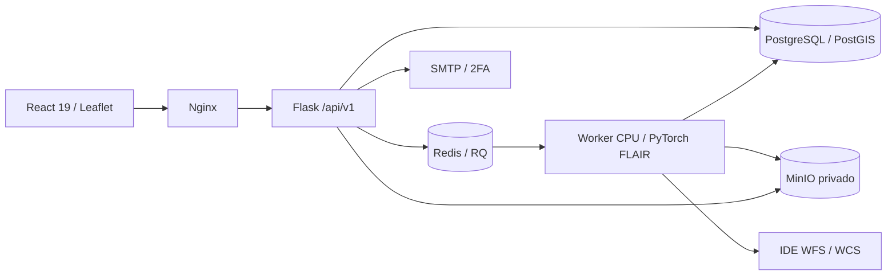
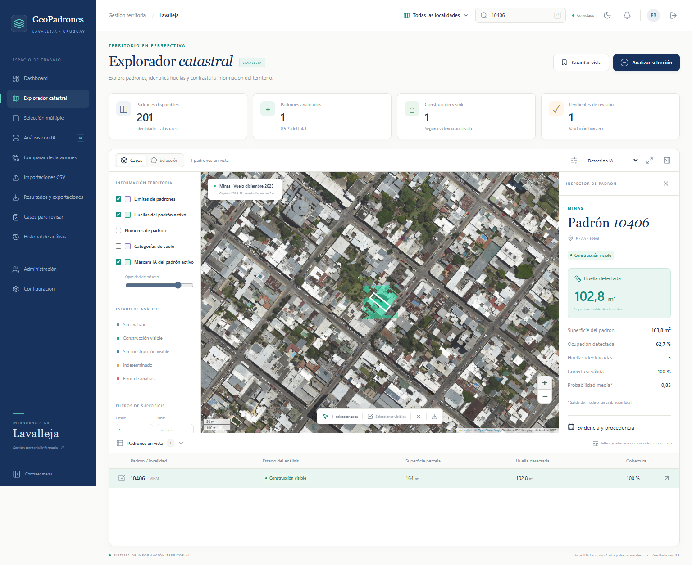
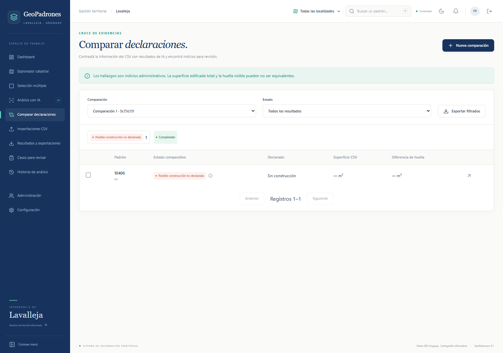

# GeoPadrones Lavalleja

Plataforma municipal de exploración catastral, segmentación de construcciones visibles, cálculo de huellas en m², comparación de declaraciones y revisión humana. Implementación real con React/Vite y Flask, PostgreSQL/PostGIS, RQ/Redis y MinIO. **El flujo principal fue probado de extremo a extremo con ortofoto, parcelas e inferencia reales. No se certifica todavía precisión local ni habilitación para producción institucional.**

## Acceso temporal para pruebas locales

Por pedido del usuario, la instancia local puede entrar directamente sin autenticación. Login, captcha numérico y doble factor están preservados en el código y en el checkpoint `auth-captcha-2fa-preserved`. El login sigue disponible en `/login`. Activar/desactivar mediante `scripts/set_local_preview.py on|off --restart`; solo development/localhost, bloqueado en producción. Ver [modos de acceso](docs/AUTH_MODES.md).

## Ejecutar

Requiere Docker/Compose v2, Python 3.11 y recursos disponibles (orientación inicial: 4 CPU, 8 GB RAM y 15 GB de disco). Desde la raíz:

```powershell
python scripts/init_local.py
docker compose -f docker-compose.yml -f docker-compose.dev.yml build
docker compose -f docker-compose.yml -f docker-compose.dev.yml run --rm models
docker compose -f docker-compose.yml -f docker-compose.dev.yml up -d
docker compose exec backend flask create-admin
docker compose exec backend flask register-model /data/models/manifest.json
docker compose exec backend flask register-imagery
```

Abrir **http://localhost:8787**. El administrador inicial se crea con prompts y contraseña oculta; no existe cuenta persistente por defecto. Correo de pruebas en http://localhost:8125. En producción usar SMTP institucional con TLS/SSL y variables privadas, sin el override dev.

Para datos catastrales desde Python local:

```powershell
python -m venv .venv
.\.venv\Scripts\python.exe -m pip install -r backend/requirements-dev.txt
.\.venv\Scripts\python.exe scripts/download_cadastre.py
.\.venv\Scripts\python.exe scripts/import_cadastre.py data/raw/lavalleja.ndjson
.\.venv\Scripts\python.exe scripts/download_cadastre.py --land-use --output data/raw/land-use.ndjson
.\.venv\Scripts\python.exe scripts/import_cadastre.py data/raw/land-use.ndjson --land-use
```

También pueden ejecutarse esos scripts en el contenedor API: copiar el archivo y su manifiesto a `/data/runtime/import/`, luego ejecutar el importador contra esa ruta. Véase [Docker](docs/deployment/DOCKER.md).

La instancia local preparada durante el desarrollo ya tiene 25.994 geometrías catastrales oficiales, agrupadas en 25.953 identidades de 18 localidades, 117 categorías de suelo, escena Minas 2025 y modelo registrado. Se detectaron 41 piezas adicionales con claves repetidas. Los totales se obtuvieron de la fuente; no se codifican como constantes.

## Arquitectura y referencias



Las referencias obligatorias están clonadas en sample/frontend y sample/backend y excluidas de Git y de los builds. Auditoría y SHA exactos en [ARQUITECTURA_SAMPLE](docs/ARQUITECTURA_SAMPLE.md). Se conservan factory Flask, extensiones, SQLAlchemy/Alembic, sesiones Flask-Login, Argon2, CSRF, Marshmallow, Blueprints y separación por servicios; frontend por features, Axios central, React Query, Zustand, RHF/Zod, Tailwind/DaisyUI, Framer Motion y diseño institucional.

PostGIS sustituye MariaDB para GiST, consultas por bbox, MVT e intersecciones métricas. Las geometrías originales y reparaciones se versionan. Cuando cambia la geometría de una parcela se invalida su resultado actual, conservando la inferencia histórica. Las correcciones humanas no sobrescriben resultados automáticos.

## Evidencia real

El benchmark sobre 260 × 260 m de Minas utiliza GeoTIFF oficial en EPSG:5382, remuestreado de 5 a 20 cm. Procesó 1300 × 1300 píxeles en aproximadamente 9 s de inferencia CPU y generó 74 polígonos antes de intersecar con parcelas. Estos números son resultados de ejecución, **no una evaluación de precisión**.

El checkpoint oficial llamado `FLAIR-INC_rgb_12cl_resnet34-unet` contiene realmente **19 canales de salida** en la revisión verificada. Se carga estrictamente, con weights_only, normalización RGB 0–255 y building en canal 0. La correspondencia y hashes se documentan en [ADR-002](docs/decisions/ADR-002-flair-checkpoint.md).

Las capturas de `docs/screenshots/` se obtienen del test real de navegador sobre una muestra temporal de parcelas oficiales. Su CSV es una declaración **sintética identificada exclusivamente para QA**. Ninguna cuenta ni declaración QA se incorpora a la instancia principal.





## Pruebas

```powershell
.\.venv\Scripts\python.exe -m pytest backend/tests --junitxml=artifacts/tests/backend.xml
npm --prefix frontend ci
npm --prefix frontend test
npm --prefix frontend run lint
npm --prefix frontend run build
```

Los tests backend crean y eliminan una base PostGIS aleatoria aislada. Incluyen CSRF, 2FA, bloqueo, replay, roles, revocación, importación, duplicados, intersecciones exactas, CRS, cobertura, filtros, revisión concurrente, exportación segura, cuotas y versionado.

End-to-end: `scripts/qa_server.py` crea una base, bucket, cola y cuenta de fixture temporales, carga una muestra oficial y levanta un worker Docker. Iniciar Vite en frontend (`$env:VITE_PROXY_TARGET="http://127.0.0.1:5051"; npm run dev`, proxy exclusivo de QA) y ejecutar `npm run test:e2e` con Edge/Chromium. Detener el servidor al finalizar; si una interrupción del sistema impide su finally, `scripts/qa_cleanup.py NOMBRE_EXACTO_BASE_QA` limpia únicamente recursos con formato y manifiesto de propiedad verificados. No usar fixtures como evidencia administrativa.

La suite actual contiene 86 pruebas backend, 10 frontend y tres pruebas de aceptación Playwright. Incluye selección múltiple, filtros, orden y exportación de resultados históricos. La comprobación de dependencias documentada no detectó vulnerabilidades conocidas; no sustituye el mantenimiento continuo.

Reportes, máscaras, GeoJSON, benchmark y capturas se guardan en artifacts/, excluido de Git. [Verificación ejecutada](docs/validation/VERIFIED_RUN.json), [informe del modelo](docs/validation/MODEL_REPORT.md), [estado por misión](docs/missions/STATUS.md), [plan](docs/missions/PLAN.md), [OpenAPI](docs/api/openapi.json).

## Operación y límites

- Imagen y modelo están versionados con fuente, fecha y hash. La captura se muestra como diciembre 2025, conservando precisión de mes.
- Huella visible no equivale a superficie total edificada ni a una determinación jurídica. Ausencia de datos se clasifica como indeterminada.
- Descargas e inferencias por sectores: límite de 100 padrones / 100.000 m² por trabajo, 16 millones de píxeles, CSV 10 MB y cuota de objetos configurable. [Selección múltiple](docs/BULK_SELECTION.md) admite 5.000 padrones por lote y lo divide en subtareas de hasta 50, con analítica, orden y CSV de todos los casos filtrados. No se infiere automáticamente todo el departamento.
- PostgreSQL, Redis y MinIO son privados en Compose principal. Producción exige cookies Secure, HTTPS y rol de base sin privilegios administrativos; [ADR-003](docs/decisions/ADR-003-production-roles.md).
- MinIO se compila desde fuente oficial archivada y commit fijado, porque las imágenes públicas probadas no están disponibles. Su mantenimiento y licencia AGPL deben revisarse antes de producción.
- Pendientes: etiquetado independiente de al menos 200 padrones; evaluación de otras ortofotos/localidades; completar vínculo normativo de categorías; ensayo de carga y validación de la infraestructura productiva. Ver el estado detallado, sin marcar esos puntos como terminados.

Guías: [usuario](docs/USER_GUIDE.md), [Docker](docs/deployment/DOCKER.md), [Coolify](docs/deployment/COOLIFY.md), [backup/restauración](docs/deployment/BACKUP_RESTORE.md), [procedencia y licencias](docs/data-sources/PROVENANCE.md).

No se leyó ni copió el .env del backend de referencia. Sus responsables deben revisar y rotar credenciales posiblemente expuestas. No se hizo push ni publicación externa.

## Problemas frecuentes

Si un servicio no está saludable, revisar `docker compose ps` y sus logs antes de reintentar; no borrar volúmenes. Los healthchecks internos usan IPv4 explícita donde el servicio no escucha IPv6. Si un puerto está ocupado, cambiar el puerto de este proyecto, sin detener otras aplicaciones.

Un análisis en PENDING espera al dispatcher/Redis; un FAILED expone una categoría de error y conserva el historial. Revisar el worker y la disponibilidad del modelo, fuente IDE, espacio y cobertura antes de recuperarlo. Una parcela sin cobertura no se clasifica como baldío.

Una recuperación que abre una URL equivocada indica FRONTEND_URL desactualizada: usar la dirección de la interfaz activa. Si falla el 2FA, comprobar SMTP o Mailpit y la hora del servidor; nunca desactivar CSRF ni registrar códigos en logs. Para desarrollo Python, pytest ya configura el import path del backend.
