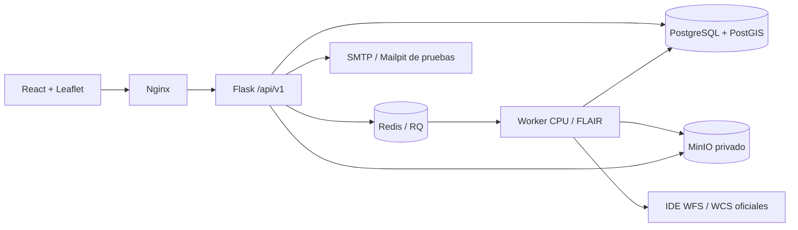

# Auditoría de los boilerplates

Fecha: 2026-10-30. Ambos repositorios fueron clonados en `sample/`, excluido del proyecto y de los contextos Docker. El archivo `.env` del backend **no fue leído ni copiado**.

| Referencia | Commit auditado |
| --- | --- |
| IntendenciaDeLavalleja/buzon-ciudadano-frontend | `811a6a29016842e8aa6b82134fb2bd5dbcb3a576` |
| IntendenciaDeLavalleja/buzon-ciudadano-backend | `3198d34ed3c15cee47caa33ef73e94dbfd16b6ed` |

## Frontend

Se estudiaron App, main, componentes, features/tickets, formularios Zod, hooks React Query, Axios, utils, estilos, Vite, TypeScript, ESLint, Docker y Nginx. El original declara React 19.2, Vite 6.3, TS 5.9, Tailwind 4.1, DaisyUI 5.5, React Query 5.90, Axios 1.13, Zustand 5, RHF 7.71, Zod 4.3 y React Leaflet 5 con Leaflet 1.9. Se inspeccionó también su package-lock.json: resuelve React 19.2.3, Vite 6.4.1, TypeScript 5.9.3, Axios 1.13.2, Tailwind 4.1.18 y DaisyUI 5.5.14. El nuevo proyecto fija versiones y genera su propio lockfile.

Se conserva la organización por features, componentes funcionales, hooks, QueryClientProvider, Toaster, Axios con credenciales, utilitario clsx/tailwind-merge, validación RHF/Zod, animaciones Framer Motion y build Vite → Nginx. Se adapta el tema institucional azul #17335D/#1B3A6B, fondo #FAFAF8, bordes #E5E1D8, títulos serif, modo oscuro y superficies redondeadas. Se descartan formularios de denuncias, tracking ciudadano, captcha público, carruseles y WhatsApp. Se añaden React Router, virtualización TanStack, iconos Lucide y pruebas Vitest/Testing Library/Playwright.

## Backend

Se estudiaron factory, configuración, extensiones, modelos User/TwoFactorCode, rutas admin/public, comandos, servicios de correo/MinIO, seguridad, migraciones, health, métricas y contenedores. Conservamos Flask 3, SQLAlchemy 2, Flask-SQLAlchemy 3, Alembic/Flask-Migrate, Marshmallow 4, Flask-Login, Argon2, Flask-WTF, Limiter, Talisman, CORS, Redis, MinIO, correlation IDs, métricas y CLI. Separación routes → services/repositories → models.

El original usa MariaDB, administración Jinja y endpoints públicos de tickets. Se reemplaza MariaDB por PostgreSQL/PostGIS (ADR-001); administración y autenticación pasan a JSON bajo /api/v1; la sesión continúa con Flask-Login. RQ ejecuta operaciones largas y carga PyTorch exclusivamente en el worker. GeoAlchemy2, Shapely, PyProj y Rasterio implementan geometrías e inferencia georreferenciada.

## Matriz de adaptación

| Origen | Destino | Adaptación |
| --- | --- | --- |
| src/main.tsx, lib/query-client | frontend/src/main.tsx, lib/query-client | Proveedores y caché tipada |
| src/lib/axios | frontend/src/lib/axios | Mismo origen, CSRF, errores JSON y correlation ID |
| features/tickets/{schema,hooks} | features/auth, imports, parcels | RHF/Zod y mutations; nuevo dominio |
| App, Navigation, global.css | app, components/layout, styles | Escritorio cartográfico, paneles, tema institucional |
| app/__init__, config, extensions | backend/app | Factory y extensiones; validación estricta de producción |
| models/user, TwoFactorCode | models/auth | Argon2, códigos de uso único, expiración, bloqueo, revocación |
| routes/admin | routes/auth, admin | JSON y permisos de servidor |
| services/mail, minio | services/mail, storage | Sin códigos en logs, almacenamiento privado |
| models/ticket | models/cadastre, analysis, workflow | Sustituido por identidades, versiones y resultados catastrales |
| Docker, entrypoint, gunicorn | Docker, init y worker | Migración única, usuario no root, servicios privados |

## Patrones que no se reproducen

El servicio de correo original imprime códigos 2FA: se elimina ese comportamiento. El backend versiona un `.env`: sus responsables deben revisar la exposición y **rotar las credenciales que pudiera contener**, incluyendo historial. No se leyó su contenido. No se heredan exenciones CSRF de blueprints, CSP con comodines, fallback silencioso del limitador a memoria en producción, creación de admin con password en argumentos ni migraciones en cada réplica Gunicorn. Los códigos se consumen atómicamente y el usuario se revalida en cada petición.

## Licencias

No hay un LICENSE/COPYING del proyecto en ninguno de los dos repositorios auditados. La solicitud autoriza su uso como referencia en este entorno; no demuestra derechos para redistribuir código o branding de terceros. Se implementan los patrones y el diseño, sin copiar imágenes institucionales. La publicación externa requiere aclarar la licencia con sus titulares. Las dependencias conservan sus respectivas licencias; ver docs/data-sources/PROVENANCE.md.

## Arquitectura

